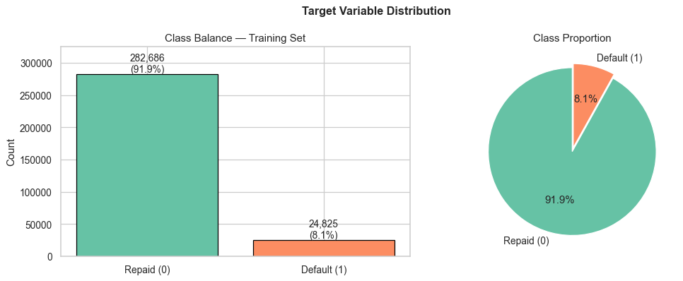
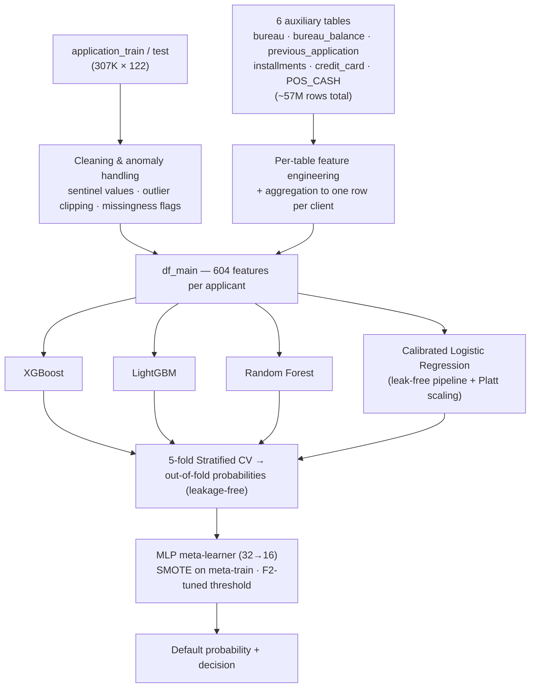
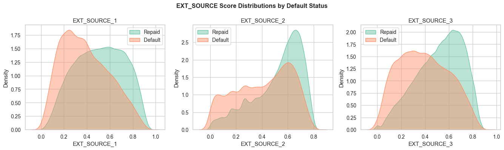

# Home Credit Default Risk — Stacked Ensemble with an MLP Meta-Learner


Predicting loan default on the [Kaggle Home Credit Default Risk](https://www.kaggle.com/competitions/home-credit-default-risk) dataset — 307K applicants, 7 relational tables, and a heavily imbalanced target (**~92% repaid / ~8% default**). The solution engineers **600+ features** from the full relational schema and stacks **four diverse base learners** (XGBoost, LightGBM, Random Forest, and a probability-calibrated Logistic Regression) under an **MLP meta-learner**, with the decision threshold tuned for **F2** — because in credit risk, missing a defaulter costs far more than a false alarm.

> 🎓 Capstone project — IIT Delhi ACPAIMLDL 07, Project #24: *Home Loan Default Risk* (team project, [see credits](#team)).



---

## Pipeline



**Stage by stage:**

1. **EDA** — class imbalance, missingness structure (67 columns with NaNs, 41 above 50%), correlation screening. The three external credit scores (`EXT_SOURCE_1/2/3`) emerge as the strongest single predictors.
2. **Cleaning & anomaly handling** — sentinel-value repair (`DAYS_EMPLOYED = 365243` → NaN + missingness flag, `XNA` gender rows dropped, income clipping), IQR-based outlier analysis, predictive missingness flags, domain-informed imputation (zero-fill for count-like features, explicit `Unknown` category for categoricals).
3. **Feature engineering** — ~600 features: EXT_SOURCE aggregates and interactions, credit/income/annuity ratios, peer-group statistics (income & credit vs. clients of the same occupation/education/age bracket), and per-table behavioural aggregates — delinquency rates, payment-timing (DPD/DBD), credit-card utilisation, and *recent-vs-all-time deterioration ratios* over 12/24/36/48/60-month windows.
4. **Base learners** — trained with 5-fold Stratified CV to produce out-of-fold (OOF) probabilities, so the meta-learner never sees a prediction made by a model that trained on that row.
5. **Calibrated LR (4th base learner)** — median imputation + `PolynomialFeatures(degree=2)` on `EXT_SOURCE × DAYS_BIRTH` inside a `ColumnTransformer`, standard scaling, L2 logistic regression, wrapped in `CalibratedClassifierCV(method="sigmoid")`. Every transformer lives **inside** the pipeline, so each CV fold fits transforms on its own training portion only — no leakage by construction.
6. **MLP meta-learner** — a small (32→16) network combines the four OOF probability columns; SMOTE balances the meta-training set; the decision threshold is chosen from the precision–recall curve to maximise **F2**.

## Results

5-fold Stratified CV out-of-fold performance (80% training split, ~246K applicants):

| Model | OOF ROC-AUC |
|---|---|
| **LightGBM** | **0.789** |
| XGBoost | 0.783 |
| Calibrated Logistic Regression | 0.777 |
| Random Forest | 0.760 |

MLP meta-learner on the stacked OOF probabilities, at the F2-optimal threshold (0.509):

| Metric | Score |
|---|---|
| **Recall (defaulters caught)** | **0.706** |
| F2 | 0.456 |
| Precision | 0.188 |

The base learners' OOF predictions correlate at only 0.77–0.95 (the calibrated LR is the most decorrelated, 0.77–0.81 vs. the tree models) — exactly the diversity stacking needs.



## My contributions

This was a 9-person team capstone. My work ([Vinayak Tyagi](https://github.com/)):

- **Exploratory data analysis** — target imbalance, missingness structure, feature–target correlation screening, categorical default-rate profiling.
- **Preprocessing & anomaly detection/removal** — sentinel-value repair, outlier analysis and clipping, missingness-flag engineering, imputation strategy.
- **Model definitions** — base-learner configurations (XGBoost / LightGBM / Random Forest) with imbalance corrections (`scale_pos_weight`, `is_unbalance`, `class_weight`).
- **Calibrated Logistic Regression pipeline** — the leak-free ColumnTransformer design with polynomial EXT_SOURCE interactions and sigmoid (Platt) calibration, added as the fourth base learner.
- **Optimization** — MLP meta-learner architecture/regularisation tuning and hyperparameter optimization across the base models.

## Repository structure

```
├── notebooks/
│   └── home_credit_stacked_ensemble.ipynb   # full pipeline: EDA → features → stacking → evaluation
├── assets/                                  # charts exported from the notebook
├── data/                                    # Kaggle data goes here (git-ignored — see data/README.md)
├── requirements.txt
└── README.md
```

## How to run

1. **Get the data** (~2.6 GB, requires a free Kaggle account — not redistributed here per competition rules):
   ```bash
   kaggle competitions download -c home-credit-default-risk -p data/
   unzip data/home-credit-default-risk.zip -d data/home-credit-default-risk/
   ```
   See [data/README.md](data/README.md) for details.
2. **Install dependencies:**
   ```bash
   pip install -r requirements.txt
   ```
3. **Run the notebook:**
   ```bash
   jupyter notebook notebooks/home_credit_stacked_ensemble.ipynb
   ```
   Full end-to-end run (feature build + 5-fold CV over 4 base learners) takes a few hours on a modern laptop; the saved notebook already contains the outputs of a completed run.

## Team

IIT Delhi ACPAIMLDL 07 — Capstone Project #24, *Home Loan Default Risk*:

Michael Richard · Lepakshi Poonamallee · Shilpi Kumari · Rajesh Kuruva · Harshitha Rudraprakash · Karthik Sudhir · Sreekanth Kumar VLN · Chintan Kansara · **Vinayak Tyagi**

## Acknowledgements

- [Home Credit Group](https://www.kaggle.com/competitions/home-credit-default-risk) for the dataset and Kaggle competition.
# home-credit-default-risk
